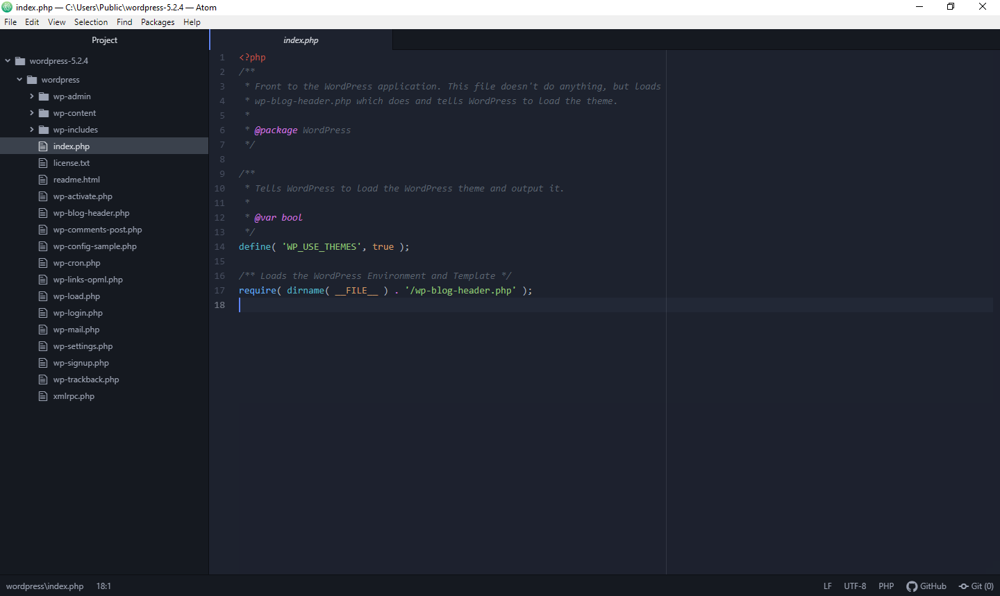

# Atom-Theme-Notepad-IDE

### Various bits and pieces for Notepad++

**Atom Theme** - A Notepad++ theme based on the Dark syntax theme from the Atom editor. This theme looks great when combined with Roboto Mono, a tasty monospaced font from Google [Google Fonts](https://fonts.google.com/specimen/Roboto+Mono)

**functionList.xml** - enable Lua in the function list (functions and top level tables)

**userDefineLang.xml** - Walter and Jesusonic definitions (Reaper theme and jsfx languages)

- Installation

Optionally, download and install Roboto Mono (highly recommended)

For a default Notepad++ installation, copy functionList.xml and userDefineLang.xml to "../AppData/Roaming/Notepad++/", and copy Atom-Theme.xml to "../AppData/Roaming/Notepad++/themes/" 

For a portable install, or one where you declined to use %appdata%, copy the files to "../Program Files(x86)/Notepad++/", and "../Program Files(x86)/Notepad++/themes/"

Restart Notepad++

## Installation steps

1. Download and install Roboto Mono if you want the recommended look. This is optional, but highly recommended.
2. For a standard Notepad++ installation, copy `functionList.xml` and `userDefineLang.xml` to:
   - `../AppData/Roaming/Notepad++/`
3. Also copy `Atom-Theme.xml` to:
   - `../AppData/Roaming/Notepad++/themes/`
4. For a portable installation, or if you did not use `%appdata%`, copy the files to:
   - `../Program Files(x86)/Notepad++/`
   - `../Program Files(x86)/Notepad++/themes/`
5. Restart Notepad++ to apply the theme.
